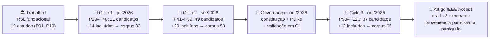
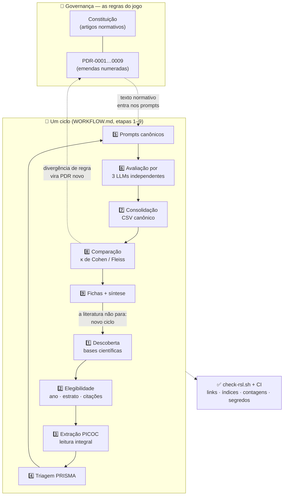
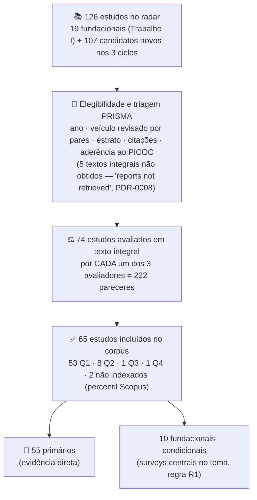
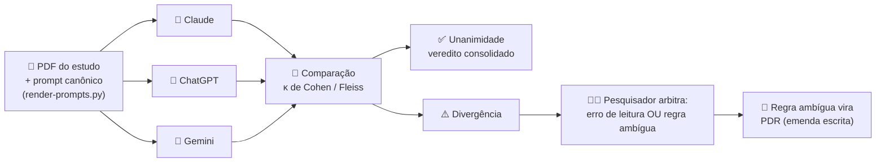

# Agentic AI como Copilot na Resposta a Incidentes — a pesquisa, apresentada

**Trabalho II · PPGCA · Unisinos** — Revisão Sistemática da Literatura (RSL) conduzida por Valdomiro de Oliveira Souza Jr., sob orientação do Prof. Dr. Rafael Kunst. Esta página apresenta o projeto de ponta a ponta: as fases, como as LLMs foram usadas como instrumento de pesquisa (com o humano no comando), os resultados e um glossário para navegar os termos técnicos.

> ⚠️ **Repositório privado.** Contém PDFs de artigos com direitos autorais (IEEE, Elsevier, Springer, MDPI, Wiley etc.) em `docs/`, mantidos apenas para a avaliação acadêmica.

## 🎯 A pergunta de pesquisa

> **A IA agêntica (Agentic AI), atuando como _copilot_ das equipes de operação, reduz o tempo de detectar (MTTD) e de resolver (MTTR) incidentes de TI?**

Em vez de rodar um experimento, esta fase da pesquisa pergunta **o que a ciência já publicou** sobre isso — com método explícito e auditável: uma RSL segundo **Kitchenham et al. (2009)**, seleção reportada em **PRISMA 2020**, escopo delimitado por **PICOC** e qualidade pontuada por critérios **DARE**. O resultado alimenta o artigo em preparação para a **IEEE Access**: _"Agentic AI Copilots for Incident Response: A Systematic Literature Review of the Evidence on MTTD and MTTR Reduction"_ ([`artigo/`](artigo/README.md)).

## 🗺️ As fases do projeto

O projeto evoluiu em uma RSL fundacional (Trabalho I) seguida de **três ciclos de atualização** — porque a literatura de Agentic AI cresce mês a mês — e, entre os ciclos 2 e 3, a mecânica da revisão foi **formalizada como protocolo versionado** (constituição + PDRs, camada [Template-RSL](https://github.com/valdomirosouza/Template-RSL)), que registrou por escrito, retroativamente, as regras já praticadas.



Cada ciclo percorre as mesmas **9 etapas** do [`WORKFLOW.md`](WORKFLOW.md), sob as regras do [`protocolo/`](protocolo/constituicao.md). Mudou uma regra no meio do caminho? Só por **PDR** (Protocol Decision Record) numerado e datado — hoje são nove ([`protocolo/pdr/`](protocolo/pdr/README.md)), do tratamento de estratos de conferência (PDR-0006) à régua internacional de elegibilidade (PDR-0009).



## 🔎 O funil de seleção, em números

Dos estudos que entraram no radar até o corpus final — cada corte com critério e evidência citados por escrito:



Fluxo detalhado, ciclo a ciclo, em [`reviews/PRISMA.md`](reviews/PRISMA.md).

## 🤖 Como as LLMs foram usadas na pesquisa

A pergunta inevitável — "uma IA revisou a literatura sobre IA?" — tem uma resposta metodológica: **LLMs foram instrumentos de leitura e avaliação, operando sob protocolo escrito, em triplicata independente e com verificação estatística; as decisões de regra foram sempre do pesquisador.** Cinco papéis distintos:

**1. Descobrir candidatos.** O prompt de busca ([`research/prompt.md`](research/prompt.md)) foi executado em três assistentes (Gemini, Claude, ChatGPT) no ciclo 1; nos ciclos seguintes a descoberta migrou para **execução direta da string de busca** (derivada do PICOC e [validada com recall 13/14](picoc/picoc-search-string.md)) nas APIs de OpenAlex e Scopus — a LLM orquestra, as bases respondem.

**2. Ler e extrair, com âncora de evidência.** Cada PDF foi lido na íntegra por agentes de leitura para a extração **PICOC** (pré-triagem) e para as **fichas estruturadas** dos incluídos (11 campos). Regra antifabricação: todo claim carrega âncora de seção/página do paper original; o que o texto não declara vira `NÃO DECLARADO`, nunca é inventado.

**3. Julgar em banca de três.** Cada estudo triado foi avaliado **independentemente por Claude, ChatGPT e Gemini** — mesmo prompt canônico (gerado por script, para que nenhum avaliador receba texto normativo diferente), mesmo formulário (RQ1–RQ5 + QA1–QA4, lógica DARE), sem ver o parecer dos demais.



**4. Medir a confiança na banca.** A concordância é verificada com estatística de confiabilidade inter-avaliadores: no conjunto global (n=74 por avaliador), **acordo de 91,9–93,2% por par, κ de Cohen 0,58–0,62, κ de Fleiss 0,60, 66/74 decisões unânimes**. As 8 divergências históricas foram todas investigadas e fecharam-se nas regras R1–R3 — e o ciclo 3, já sob essas regras, saiu **unânime (13/13, κ = 1,00)**: evidência empírica de que as regras eliminaram a ambiguidade. Dados em [`reviews/comparacao-avaliadores-global-P01-P123.md`](reviews/comparacao-avaliadores-global-P01-P123.md).

**5. Copilotar a engenharia da pesquisa.** O Claude Code atuou como copiloto de engenharia — na prática, o próprio projeto é um estudo de caso do tema da pesquisa: scripts determinísticos ([`scripts/`](scripts/check-rsl.sh)) validam links, índices, contagens e segredos em CI; o κ é recomputável por script; gráficos e PDFs são regenerados de CSVs canônicos; o artigo LaTeX foi montado e cada parágrafo ganhou um [mapa de proveniência](artigo/proveniencia-paragrafos.md) ligando a escrita às fichas e às páginas dos papers; e cada sessão de trabalho está lavrada em [`MEMORY.md`](MEMORY.md) (prompts, decisões, incidentes e commits — o "diário de bordo" auditável).

**Onde o humano decide (sempre):** ratificação de toda regra e emenda (PDRs), arbitragem de casos-limite, verificação bibliométrica externa (Scopus/OpenAlex/SCImago), acessos e logins institucionais, e a palavra final sobre inclusões com ressalva. Pareceres publicados são imutáveis; correção vira artefato novo.

## 📈 Resultados em um relance (3 ciclos)

- **Corpus final: 65 estudos** (2020–2026), com elegibilidade re-expressa na régua internacional do PDR-0009 (percentil Scopus): **53 Q1 · 8 Q2 · 1 Q3 · 1 Q4 · 2 não indexados**.
- **O achado central evoluiu entre os ciclos:** nos ciclos 1–2, _nenhum_ estudo media MTTD/MTTR nominalmente contra baseline executado — a promessa era repetida, não medida. O **ciclo 3 revelou o primeiro cluster de 4 estudos primários que medem**: MTTD −82% a −83% (P100, P102), MTTR −72,3% a −91% (P101, P100) e time-to-containment −37,8% (P123) — evidência inicial, metade abaixo da régua de veículo da revisão, nada ainda multi-site ou replicado de forma independente.
- **Lacuna persistente:** nenhum estudo mede **carga cognitiva do operador** na presença de um copilot agêntico — a fronteira apontada para trabalho futuro (e candidata natural a experimento da dissertação).
- Síntese completa: [`reviews/relatorio-sintese-consolidado.md`](reviews/relatorio-sintese-consolidado.md) · [PDF](reviews/relatorio-sintese-consolidado.pdf) · painel em [`reviews/DASHBOARD.md`](reviews/DASHBOARD.md).

## 🚀 Comece por aqui

| Quero…                            | Abra                                                                                                                                                 |
| --------------------------------- | ---------------------------------------------------------------------------------------------------------------------------------------------------- |
| O painel geral                    | 📊 [Dashboard de resultados](reviews/DASHBOARD.md)                                                                                                   |
| A análise completa (3 ciclos)     | 📄 [Síntese consolidada](reviews/relatorio-sintese-consolidado.md) · [PDF](reviews/relatorio-sintese-consolidado.pdf)                                |
| O artigo IEEE Access              | 📝 [main.tex](artigo/main.tex) · [guia do artigo](artigo/README.md) · [proveniência parágrafo a parágrafo](artigo/proveniencia-paragrafos.md)        |
| A confiabilidade da banca de LLMs | 📐 [Comparação global dos 3 avaliadores (P01–P123)](reviews/comparacao-avaliadores-global-P01-P123.md)                                               |
| O fluxo de seleção                | 🔀 [Diagrama PRISMA](reviews/PRISMA.md)                                                                                                              |
| O índice canônico de estudos      | 🧮 [Papers_Index.csv](Papers_Index.csv) · [versão legível](Papers_Index.md)                                                                          |
| As regras do jogo                 | 📜 [Constituição](protocolo/constituicao.md) · [critérios](protocolo/criterios.md) · [PDRs](protocolo/pdr/README.md) · [ciclo canônico](WORKFLOW.md) |
| As fichas de extração             | 📑 [Índice das fichas](report/README.md)                                                                                                             |
| Quem cita quem no corpus          | 🕸️ [Rede de citações P01–P123](citacoes-cruzadas-P01-P123.md)                                                                                        |
| O histórico de tudo que foi feito | 📓 [MEMORY.md](MEMORY.md) — diário de bordo das sessões                                                                                              |

## 📖 Glossário

### Método científico e RSL

| Termo                                       | Em uma frase                                                                                                                                        |
| ------------------------------------------- | --------------------------------------------------------------------------------------------------------------------------------------------------- |
| **RSL** (Revisão Sistemática da Literatura) | "Censo" do que a ciência publicou sobre um tema, com método explícito e repetível — o oposto de "li uns artigos e achei isso".                      |
| **Kitchenham (2009)**                       | O guia clássico de RSL em engenharia de software que esta revisão segue.                                                                            |
| **PICOC**                                   | População, Intervenção, Comparação, Outcomes, Contexto — a moldura que delimita que tipo de estudo interessa.                                       |
| **PRISMA 2020**                             | Padrão internacional para reportar a seleção: o "funil" de quantos entraram, quantos saíram e por quê.                                              |
| **DARE**                                    | Critérios clássicos de qualidade metodológica usados para pontuar cada estudo (QA1–QA4).                                                            |
| **RQ** (Research Question)                  | Pergunta de pesquisa; cada estudo é pontuado pelo quanto responde a cada uma (RQ1–RQ5).                                                             |
| **Estrato do veículo**                      | A "reputação" da revista/conferência: aqui, percentil CiteScore do Scopus em quartis — Q1–Q3 elegíveis (PDR-0009); Qualis e SJR viram informativos. |
| **Corpus**                                  | O conjunto final de estudos incluídos — o júri de evidências da revisão.                                                                            |
| **Snowballing**                             | "Bola de neve": vasculhar referências e citadores dos incluídos atrás de candidatos que a busca não pegou.                                          |
| **Baseline**                                | O ponto de comparação executado (ex.: o time humano, o processo antigo) sem o qual "reduziu X%" não significa nada.                                 |
| **PDR** (Protocol Decision Record)          | Emenda numerada, datada e imutável à regra da revisão — mudança de critério só existe por escrito.                                                  |
| **κ (kappa) de Cohen / Fleiss**             | Estatística de concordância entre avaliadores **descontado o acaso** (1,00 = acordo perfeito; Fleiss generaliza para 3+).                           |

### IA e LLMs

| Termo                                    | Em uma frase                                                                                                                   |
| ---------------------------------------- | ------------------------------------------------------------------------------------------------------------------------------ |
| **LLM** (Large Language Model)           | Modelo de linguagem de grande porte (ex.: Claude, GPT, Gemini) que lê e produz texto — aqui, o "leitor incansável" dos PDFs.   |
| **Prompt**                               | A instrução dada à LLM; **prompt canônico** = gerado por script para que os três avaliadores recebam exatamente o mesmo texto. |
| **RAG** (Retrieval-Augmented Generation) | Técnica em que a LLM consulta documentos externos antes de responder, para ancorar a resposta em fontes.                       |
| **Fine-tuning / SLM**                    | Ajuste fino de um modelo para uma tarefa; SLM = Small Language Model, a variante compacta e barata.                            |
| **RL** (Reinforcement Learning)          | Aprendizado por reforço: o agente aprende por tentativa, erro e recompensa.                                                    |
| **Alucinação**                           | Quando a LLM afirma com confiança algo que não está na fonte — mitigada aqui por âncoras de evidência e regras antifabricação. |

### Agentic AI

| Termo                            | Em uma frase                                                                                                       |
| -------------------------------- | ------------------------------------------------------------------------------------------------------------------ |
| **Agentic AI / agente**          | IA que não apenas responde: **planeja, usa ferramentas e executa ações** em múltiplos passos rumo a um objetivo.   |
| **Copilot**                      | O agente no papel de **assistente do humano** (recomenda, prepara, executa sob supervisão) — e não de substituto.  |
| **MAS** (Multi-Agent System)     | Sistema de múltiplos agentes cooperando, cada um com um papel (ex.: um detecta, outro diagnostica, outro remedia). |
| **MCP** (Model Context Protocol) | Protocolo aberto que padroniza como agentes se conectam a ferramentas e dados externos.                            |
| **HITL** (Human-in-the-Loop)     | O humano **aprova cada ação** do agente antes de ela acontecer.                                                    |
| **HOTL** (Human-on-the-Loop)     | O agente age sozinho e o humano **supervisiona e pode intervir** — o passo seguinte de autonomia.                  |
| **Orquestração**                 | A coordenação de vários agentes/ferramentas num fluxo só (quem faz o quê, em que ordem, com que limites).          |

### SRE e operações de TI

| Termo                                  | Em uma frase                                                                                                                 |
| -------------------------------------- | ---------------------------------------------------------------------------------------------------------------------------- |
| **SRE** (Site Reliability Engineering) | Disciplina (nascida no Google) que trata operação de sistemas como problema de engenharia — confiabilidade com automação.    |
| **Incident Response (IR)**             | O processo de detectar, diagnosticar, conter e resolver um incidente (pane, ataque, degradação) em produção.                 |
| **MTTD** (Mean Time To Detect)         | Tempo médio para **perceber** que algo quebrou.                                                                              |
| **MTTR** (Mean Time To Repair/Resolve) | Tempo médio para **resolver** — a métrica-rainha desta pesquisa, junto com o MTTD.                                           |
| **MTTC** (Mean Time To Contain)        | Tempo médio para **conter** um incidente de segurança (variante usada em SOC).                                               |
| **NOC / SOC**                          | Centros de operação de **rede** (NOC) e de **segurança** (SOC) — as equipes que vivem de plantão; SOCaaS = SOC como serviço. |
| **AIOps**                              | IA aplicada à operação de TI: detecção de anomalias, correlação de alertas, predição de falhas.                              |
| **RCA** (Root Cause Analysis)          | Análise de causa raiz: achar o _porquê_ de verdade, não só o sintoma.                                                        |
| **SIEM / SOAR**                        | SIEM agrega e correlaciona logs de segurança; SOAR orquestra e automatiza a resposta (playbooks).                            |
| **Observabilidade**                    | Logs, métricas e traces que permitem _enxergar_ o estado do sistema — a matéria-prima dos agentes de IR.                     |
| **Runbook / Playbook**                 | O passo a passo operacional de resposta — o que os copilots agênticos leem, sugerem e às vezes executam.                     |
| **Carga cognitiva**                    | O esforço mental do operador durante o incidente — a lacuna de medição apontada por esta revisão.                            |

---
## 📁 Estrutura do repositório

```
.
├── README.md                     ← este arquivo (índice geral)
├── CLAUDE.md                     ← instruções de sessão (regra de dump de memória em MEMORY.md + convenções)
├── MEMORY.md                     ← memória das sessões (prompts, iterações, respostas, commits)
├── WORKFLOW.md                   ← ciclo canônico da RSL (9 etapas; camada Template-RSL)
├── CHANGELOG.md                  ← changelog do protocolo (emendas e versões)
├── CITATION.cff                  ← como citar os artefatos desta revisão
├── LICENSE                       ← MIT
├── protocolo/                    ← camada de governança (Template-RSL, adotada 2026-10-27)
│   ├── constituicao.md          ← artigos normativos da revisão (raiz de autoridade)
│   ├── picoc.md · criterios.md  ← PICOC ratificado e critérios I1–I6/E1–E5 com R1–R3
│   └── pdr/                     ← PDR-0001..0009 — decisões de protocolo numeradas e imutáveis
├── scripts/                      ← validação determinística (camada Template-RSL)
│   ├── check-rsl.sh             ← links · PDRs · indexação · segredos · pareceres×CSV (roda no CI)
│   ├── compute-kappa.py         ← κ Cohen/Fleiss (reproduz a comparação global)
│   ├── render-prompts.py        ← template canônico → prompts por estudo
│   ├── derive-index.py          ← Papers_Index.csv → Papers_Index.md
│   └── ingest-downloads.py      ← ingere PDFs de ~/Downloads para docs/ com nome canônico
├── templates/                    ← templates canônicos do ciclo (prompts, parecer, triagem, CSVs)
├── Artigos-TrabalhoII.csv        ← insumos: ID, artigo, arquivo, Qualis, SJR
├── papers.csv                    ← bibliometria VERIFICADA (P01–P40): DOI, Qualis 2025-2028, Scopus %, SJR, ISSN, ano
├── Papers_Index.csv              ← índice canônico P01–P126 (metadados, bibliometria, status RSL, escores dos 3 avaliadores)
├── Papers_Index.md               ← versão Markdown legível do índice (derivada do CSV)
├── artigo/                       ← draft v2 do artigo IEEE Access (main.tex + referencias.bib + proveniência)
├── bio/                          ← biografias dos autores (insumo das seções biography do artigo)
│   └── ValdomiroSouza.pdf       ← perfil profissional do autor (export LinkedIn)
├── papers-ciclo2.csv             ← elegibilidade Etapa 1 do ciclo 2 (P41–P89): 45 elegíveis · 4 inelegíveis
├── papers-ciclo3.csv             ← elegibilidade Etapa 1 do ciclo 3 (P90–P126): 4 elegíveis · 15 c/ ressalva · 18 inelegíveis (PDR-0006/0007)
├── TrabalhoI/                    ← RSL fundacional (base do corpus e do prompt)
│   ├── README.md                ← índice do Trabalho I
│   ├── Artigo_Agentic_AI V3.pdf ← artigo da RSL original
│   ├── Artigo_Agentic_AI V3_Latex.zip ← fontes LaTeX do artigo
│   └── References/              ← 19 estudos incluídos (P1–P19)
├── research/                     ← Etapa 1: descoberta de candidatos (ciclos 1 e 3)
│   ├── README.md                ← índice da descoberta
│   ├── prompt.md                ← prompt de busca/triagem (EN)
│   ├── gemini-research-report.md  ← candidatos levantados pelo Gemini
│   ├── claude-research-report.md  ← candidatos levantados pelo Claude
│   └── chatgpt-research-report.md ← candidatos levantados pelo ChatGPT
├── prompts/                      ← Etapa 2: prompts de avaliação
│   ├── prompt-chatgpt-consultation.md ← template do prompt de avaliação (papel, RQs, QA, saída)
│   ├── prompt-P01..P19.md       ← 19 prompts preenchidos (corpus fundacional, avaliação retroativa)
│   ├── prompt-P20..P40.md       ← 20 prompts preenchidos (ciclo 1, registro histórico)
│   └── prompt-P43..P88.md       ← 22 prompts preenchidos (ciclo 2, aprovados na triagem)
├── docs/                         ← PDFs: corpus P01–P40 (39) + ciclo 2 P41–P89 (49) + ciclo 3 P90–P126 (32; 5 Springer sem acesso) + Kitchenham (2009)
├── report/                       ← Etapa 3: fichas de extração estruturada
│   ├── README.md                ← índice das fichas (P01–P40)
│   ├── paper-extraction-prompt-template.md ← template de extração (11 campos, Kitchenham)
│   ├── Pxx-extraction.csv       ← 71 fichas em inglês (39 corpus + 20 ciclo 2 + 12 ciclo 3)
│   ├── Pxx-extraction-ptBR.csv  ← 59 fichas em português (termos técnicos em EN)
│   └── consolidated-extraction[-ptBR].csv ← consolidados (uma linha por artigo)
├── picoc/                        ← Etapa 4: extração PICOC (delimitação de escopo)
│   ├── picoc-extraction-prompt.md ← prompt de extração PICOC (Kitchenham; Petticrew & Roberts)
│   ├── picoc-results-consolidated-P01-P40-{Claude,ChatGPT,Gemini}.md ← tabelas consolidadas por avaliador
│   └── picoc-results-consolidated-P41-P89-Claude.md ← extração PICOC do ciclo 2 (pré-triagem)
├── bookmark.md                   ← bookmarks de recursos externos (QUALIS etc.)
├── citacoes-cruzadas.md          ← citações entre os 39 artigos do corpus (OpenAlex × Crossref × Scopus)
├── citacoes-cruzadas-P01-P89.md  ← versão ampliada P01–P89 (49 arestas; OpenAlex × Crossref, Scopus pendente)
├── referencias.csv               ← referências citadas pelos artigos (extraídas via DOIS.py)
├── DOIS.py                       ← script de extração de referências (Crossref/OpenAlex/S2/COCI)
├── DOIS.txt                      ← lista de DOIs de entrada do DOIS.py
└── reviews/                      ← Etapa 2: avaliação e síntese
    ├── DASHBOARD.md              ← painel central (hub de tudo)
    ├── README.md                 ← índice/tabela-síntese dos pareceres
    ├── relatorio-sintese.md/.pdf ← análise agregada (com gráficos)
    ├── resultados-consolidados.csv ← matriz de escores (RQ/QA/banda/recomendação)
    ├── graficos.md               ← galeria dos gráficos
    ├── COMO-CRIAR-GRAFICOS.md     ← how-to de geração dos gráficos
    ├── review-P20..P40.md        ← 20 pareceres do revisor
    ├── charts/                   ← 5 gráficos SVG
    ├── scripts/                  ← geradores (gen_charts.py, build_pdf.py)
    └── ChatGPT/                  ← avaliações comparativas (P20–P40, sem P36)
```

<details>
<summary><strong>📚 Índice cumulativo por categoria</strong> — todos os artefatos, com as notas datadas de cada ciclo (clique para expandir)</summary>

## 📚 Documentos por categoria

### Base fundacional (Trabalho I)

- [`TrabalhoI/`](TrabalhoI/) — **RSL fundacional** do mestrado: o artigo (PDF + fontes LaTeX) e os **19 estudos incluídos (P1–P19)**. É o corpus corrente que serviu de **referência para construir o [prompt de busca](research/prompt.md)** da Etapa 1 e a base de deduplicação dos candidatos. Ver [`TrabalhoI/README.md`](TrabalhoI/README.md).

### Descoberta de candidatos (Etapa 1)

- [`research/`](research/) — **descoberta de artigos candidatos** para ampliar o corpus, executando o mesmo prompt de busca em **Gemini**, **Claude** e **ChatGPT**. Insumos exploratórios (Qualis/SJR/citações majoritariamente `UNVERIFIED`) que originaram os estudos P20–P40. Ver [`research/README.md`](research/README.md).

### Insumos (entrada)

- [`prompts/prompt-chatgpt-consultation.md`](prompts/prompt-chatgpt-consultation.md) — template do prompt de avaliação/consulta ao ChatGPT (papel, contexto, RQ1–RQ5, QA1–QA4, formato de saída).
- [`Artigos-TrabalhoII.csv`](Artigos-TrabalhoII.csv) — metadados dos estudos (ID, arquivo, Qualis, SJR) usados como insumo na avaliação (valores então `[VERIFICAR]`).
- [`papers.csv`](papers.csv) — **bibliometria verificada** dos 39 estudos (P01–P40): DOI, veículo, **Qualis 2025-2028**, **percentil Scopus**, **SJR quartile**, ISSN, ano e **contagem de citações em três fontes** (OpenAlex, Crossref, Scopus — verificadas em 2026-07-27). Resolve integralmente a pendência transversal (Qualis/SJR/citações).
- [`Papers_Index.csv`](Papers_Index.csv) — índice completo P01–P89 (título, autores, ano, veículo, cluster, tipo, citações, DOI, percentil Scopus, SJR, ISSN, arquivo) **+ colunas de resultado (2026-10-26)**: Status RSL por estudo e SCORE_RQ/SCORE_QA/recomendação dos três avaliadores (Claude, ChatGPT, Gemini). Versão legível: [`Papers_Index.md`](Papers_Index.md).
- [`papers-ciclo2.csv`](papers-ciclo2.csv) — **elegibilidade Etapa 1 do ciclo 2** (P41–P89): citações **OpenAlex e Crossref verificadas em 2026-09-09 e Scopus em 2026-10-26** (três fontes completas; todos ≥ 1), **Qualis derivado do percentil Scopus** pela regra CAPES 2025-2028 (A1 ≥ 87,5% · A2 ≥ 75% · A3 ≥ 62,5%, calibrada nos 39 pares verificados de `papers.csv`) e veredito por candidato: **45 ELEGÍVEIS · 4 INELEGÍVEIS** (P62/P69 Qualis A3, P81 A4, P86 B1 + SJR Q3).
- [`reviews/triagem-ciclo2.md`](reviews/triagem-ciclo2.md) — **triagem PRISMA do ciclo 2** (2026-09-09), ancorada na extração PICOC de leitura integral: 49 triados → **22 aprovados para avaliação integral** (os 4 fora de estrato mantidos com ressalva, por emenda de protocolo) · **27 excluídos** (E2 não-agêntico = 19 · E3 fora de domínio = 8, com precedentes do ciclo 1).
- [`reviews/triagem-ciclo3.md`](reviews/triagem-ciclo3.md) — **triagem PRISMA do ciclo 3** (2026-10-28), ancorada na extração PICOC do ciclo 3: 19 elegíveis → 5 adiados (texto integral não obtido, Springer) → 14 triados → 1 excluído (**E3**: P108, fora do domínio IR/AIOps) → **13 aprovados para avaliação integral** (P94 e P97 plenos + 11 com ressalva de estrato, PDR-0006/0007). Caso-limite P106 ("Agentic AI" nominal, ML/DRL) aprovado com flag pelos precedentes P73/P88; seção nova do ciclo 3 em [`reviews/PRISMA.md`](reviews/PRISMA.md).
- **Avaliação e consolidação do ciclo 2** (2026-09-10) — 22 pareceres (`reviews/review-P43.md`…`review-P88.md`): **20 Incluir c/ ressalvas · 2 Excluir** (P85, P86); escores em [`reviews/resultados-consolidados-ciclo2.csv`](reviews/resultados-consolidados-ciclo2.csv), gráficos em [`reviews/graficos-ciclo2.md`](reviews/graficos-ciclo2.md), fluxo PRISMA do ciclo 2 em [`reviews/PRISMA.md`](reviews/PRISMA.md) e painel em [`reviews/DASHBOARD.md`](reviews/DASHBOARD.md). **Corpus consolidado: 53 estudos** (33 + 20; 7 fundacionais condicionais no total).
- [`reviews/PRISMA.md`](reviews/PRISMA.md) — **diagrama PRISMA 2020** (Mermaid) do fluxo de seleção: ≈51 identificados → 21 candidatos → 20 triados → 18 avaliados → **14 incluídos** → corpus final **33** (19 fundacionais + 14 novos), com critérios de inclusão (I1–I6) e exclusão (E1–E5) e verificação por artefato.
- [`citacoes-cruzadas.md`](citacoes-cruzadas.md) — **citações entre os 39 artigos do corpus** com tripla checagem (OpenAlex × Crossref × Scopus): 26 pares citador→citado; hubs P10 (7), P14 (5), P09 (4); inclui a descoberta de que o `REF()` do Scopus casa por título (não por DOI) e o caso do P09 citado via DOI de preprint.
- [`citacoes-cruzadas-P01-P123.md`](citacoes-cruzadas-P01-P123.md) — **extensão da rede ao ciclo 3** (2026-10-30): +13 arestas dos 12 incluídos (full-text + OpenAlex), total 65; P14 sobe a 7 citações internas, P76 vira hub, P97 empata como maior citador (7 saídas). Base da Fig. 2 do draft v2 do artigo.
- [`citacoes-cruzadas-P01-P89.md`](citacoes-cruzadas-P01-P89.md) — **versão ampliada do corpus P01–P89 com tripla checagem completa** (OpenAlex 48 × Crossref 45 × **Scopus 48**, união **52 pares**; OA/CR 2026-10-25, Scopus 2026-10-26): hubs P10 (7), P09 (6), P14 (5), P16 e P65 (3); **P28 é o maior citador interno** (7 arestas, incl. 5 candidatos do ciclo 2); 3 arestas exclusivas do Scopus (P54←P06/P15, P16←P29).
- [`prompts/`](prompts/) — template de avaliação + 61 prompts preenchidos, um por estudo: **P01–P19** (corpus fundacional, avaliação retroativa de padronização — não rediscutem a inclusão herdada do Trabalho I; Qualis/SJR verificados de `papers.csv`), **P20–P40** (ciclo 1, registro histórico) e **P43–P88** (ciclo 2).
- [`docs/`](docs/) — PDFs: os **39 do corpus** P01–P19 (fundacionais do Trabalho I) + P20–P40 (candidatos avaliados), com índice completo em [`report/README.md`](report/README.md); os **49 candidatos do ciclo 2** (P41–P89, aguardando triagem — extração PICOC em [`picoc/picoc-results-consolidated-P41-P89-Claude.md`](picoc/picoc-results-consolidated-P41-P89-Claude.md)); e o paper metodológico de **Kitchenham (2009)**.
- [`DOIS.py`](DOIS.py) + [`DOIS.txt`](DOIS.txt) — script e lista de DOIs para extrair as referências citadas pelos artigos (Crossref, OpenAlex, Semantic Scholar, OpenCitations) → gera [`referencias.csv`](referencias.csv).

### Avaliação & síntese (saída)

- [`reviews/DASHBOARD.md`](reviews/DASHBOARD.md) — **painel central**.
- [`reviews/relatorio-sintese.md`](reviews/relatorio-sintese.md) / [`.pdf`](reviews/relatorio-sintese.pdf) — relatório de síntese.
- [`reviews/resultados-consolidados.csv`](reviews/resultados-consolidados.csv) — dados consolidados.
- [`reviews/README.md`](reviews/README.md) — índice dos pareceres.
- [`reviews/graficos.md`](reviews/graficos.md) — galeria · [`reviews/charts/`](reviews/charts/) — SVGs.
- [`reviews/review-P20.md` … `review-P40.md`](reviews/) — 20 pareceres.

### Extração de dados (Etapa 3)

- [`report/`](report/) — **fichas de extração estruturada** dos 39 artigos do corpus e dos **20 incluídos do ciclo 2** (metodologia Kitchenham, 11 campos com foco em MTTD/MTTR e Agentic AI). Uma ficha por artigo em inglês (`Pxx-extraction.csv`) e português (`Pxx-extraction-ptBR.csv`), mais os consolidados [`consolidated-extraction.csv`](report/consolidated-extraction.csv) / [`-ptBR`](report/consolidated-extraction-ptBR.csv). Template em [`report/paper-extraction-prompt-template.md`](report/paper-extraction-prompt-template.md). Ver [`report/README.md`](report/README.md).

### Extração PICOC (Etapa 4)

- [`picoc/picoc-extraction-prompt.md`](picoc/picoc-extraction-prompt.md) — prompt de extração **PICOC** (Population, Intervention, Comparison, Outcomes, Context) sobre os 39 PDFs, com regras antifabricação (`NÃO DECLARADO` / `N/A`) e âncoras de evidência. **v1.1.0**: Comparison = DECLARED somente com baseline empírico (contraste conceitual → `N/A`).
- [`picoc/picoc-results-consolidated-P01-P40-Claude.md`](picoc/picoc-results-consolidated-P01-P40-Claude.md) — **tabela PICOC consolidada** (39 artigos) com síntese transversal e raciocínio por artigo; achado central: nenhum estudo mede MTTD/MTTR nominalmente.
- [`picoc/picoc-results-ciclo3.md`](picoc/picoc-results-ciclo3.md) — **tabela PICOC consolidada do ciclo 3** (2026-10-28, pré-triagem): 14 dos 19 candidatos aprovados na Etapa 2 extraídos via template canônico (`templates/prompt-extracao-picoc.md`, prompts por estudo em [`prompts/picoc-ciclo3/`](prompts/picoc-ciclo3/), fragmentos por agente em [`picoc/fragments-ciclo3/`](picoc/fragments-ciclo3/)); 5 capítulos Springer pendentes de acesso. Destaques: Comparison empírico forte em P100 (MTTR −63% vs. SREs), P101 (MTTR −72,3%), P102 (MTTD −82%) e P123 (MTTC −37,8%); P108 sem relação com incident response e P106 "Agentic AI" só nominal (ML/DRL) — insumos para E2/E3 na triagem.
- [`picoc/picoc-results-consolidated-P41-P89-Claude.md`](picoc/picoc-results-consolidated-P41-P89-Claude.md) — **tabela PICOC consolidada do ciclo 2** (49 candidatos P41–P89, prompt v1.3.0, pré-triagem): 26 DECLARED · 13 N/A mapeamento · 9 N/A conceitual · 1 NÃO DECLARADO; MTTD/MTTR nominal segue quase ausente (só P76, vs. literatura) e surge um **cluster humano** com medição direta de carga cognitiva/fadiga (P62, P69, P81, P85), inexistente em P01–P40.
- [`picoc/picoc-results-consolidated-P01-P40-ChatGPT.md`](picoc/picoc-results-consolidated-P01-P40-ChatGPT.md) · [`-Gemini-Atualizado.md`](picoc/picoc-results-consolidated-P01-P40-Gemini-Atualizado.md) — execuções paralelas do mesmo prompt em ChatGPT e Gemini, para comparação entre avaliadores. _(A [versão original do Gemini](picoc/picoc-results-consolidated-P01-P40-Gemini.md) não cobria P01–P09 e é mantida como registro histórico.)_
- [`picoc/picoc-comparacao-avaliadores.md`](picoc/picoc-comparacao-avaliadores.md) — **comparação Claude × ChatGPT × Gemini** da extração PICOC sobre os 39 artigos (acordo 100% em 4 elementos; Comparison 79%, Fleiss κ = 0,37 — divergência definicional sobre contraste conceitual em estudos secundários). Os 12 casos divergentes foram **reclassificados pela regra v1.1.0** (resultado final: 26 DECLARED · 13 N/A, coluna `Comparison_Final_Protocolo`) · dados em [`picoc/picoc-comparacao-avaliadores.csv`](picoc/picoc-comparacao-avaliadores.csv).
- [`picoc/picoc-search-string.md`](picoc/picoc-search-string.md) — **string de busca da RSL** derivada da síntese PICOC (blocos Intervention × Context; Outcomes só como refinamento opcional), **calibrada contra o corpus** e **validada em execução real na OpenAlex e no Scopus** (Scopus Search API, por DOI): recall **13/14 dos estudos incluídos nas três validações** (única perda: P24, trade-off documentado); excluídos/inelegíveis não recuperados (comportamento desejável); volume no Scopus **12.783** (2020+, EN) vs. ≈ 49,7 mil na OpenAlex. Sintaxes para Scopus, WoS, IEEE Xplore e ACM DL. Nota: P01 não é indexado pelo Scopus.

### Ferramentas

- [`reviews/scripts/`](reviews/scripts/) — geradores ([`gen_charts.py`](reviews/scripts/gen_charts.py), [`build_pdf.py`](reviews/scripts/build_pdf.py)) + [README](reviews/scripts/README.md).
- [`reviews/COMO-CRIAR-GRAFICOS.md`](reviews/COMO-CRIAR-GRAFICOS.md) — how-to dos gráficos.

### Comparação

- [`reviews/ChatGPT/`](reviews/ChatGPT/) — avaliações paralelas dos 20 estudos (P20–P40, sem P36) com ChatGPT, para comparação entre avaliadores; índice por estudo em [`reviews/README.md`](reviews/README.md#avaliações-comparativas-chatgpt). _(Conjunto separado dos pareceres oficiais `review-Pxx.md`.)_
- [`reviews/comparacao-avaliadores.md`](reviews/comparacao-avaliadores.md) — **comparação Claude × ChatGPT** (concordância de decisão 90%, κ = 0,74) · dados em [`reviews/comparacao-avaliadores.csv`](reviews/comparacao-avaliadores.csv).

</details>

## 🔁 Reproduzir

```bash
python3 reviews/scripts/gen_charts.py   # CSV → gráficos SVG
python3 reviews/scripts/build_pdf.py    # relatório + SVGs → PDF
```

Detalhes em [`reviews/scripts/README.md`](reviews/scripts/README.md) e [`reviews/COMO-CRIAR-GRAFICOS.md`](reviews/COMO-CRIAR-GRAFICOS.md).

---

_Página reescrita em 2026-10-30 como apresentação do projeto (fases, uso das LLMs, glossário e diagramas). A versão anterior do README permanece no histórico git; os artefatos citados nas notas datadas do índice cumulativo são registros históricos e não foram alterados._
