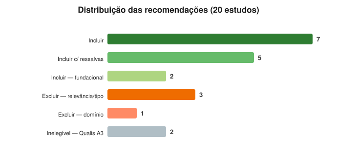
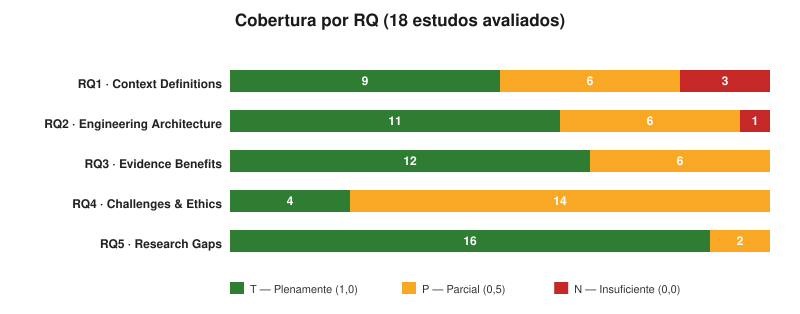
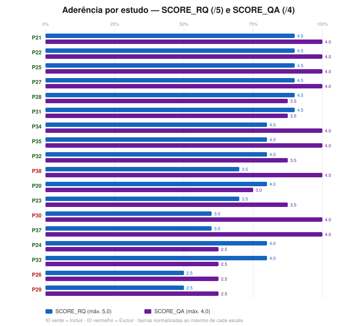
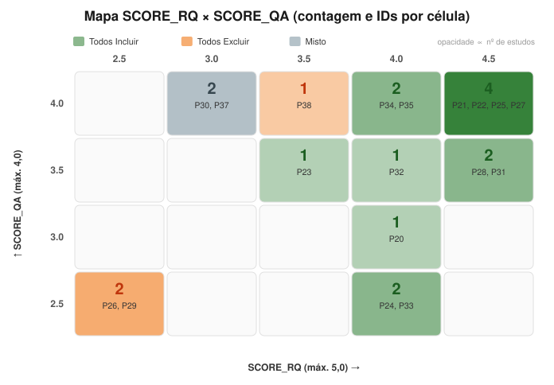
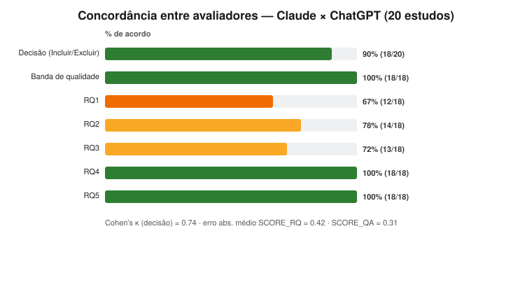

# 📊 Dashboard de Resultados — RSL "Agentic AI Copilot para Resposta a Incidentes"

Painel central que reúne **todos os artefatos** da avaliação dos estudos candidatos **P20–P40** (20 estudos; P36 era duplicata de P31/LEMAD, removida).

## 🔗 Navegação rápida

| Artefato                                                                                     | Descrição                                                                                                                                                             |
| -------------------------------------------------------------------------------------------- | --------------------------------------------------------------------------------------------------------------------------------------------------------------------- |
| 📄 [Relatório de síntese (MD)](relatorio-sintese.md) · [PDF](relatorio-sintese.pdf)          | Análise agregada: funil, cobertura por RQ, qualidade, ranking, achados                                                                                                |
| 🧮 [Resultados consolidados (CSV)](resultados-consolidados.csv)                              | Matriz machine-readable: RQ1-5, QA1-4, escores, banda, recomendação                                                                                                   |
| 🖼️ [Galeria de gráficos](graficos.md)                                                        | Os 5 gráficos com leitura                                                                                                                                             |
| 📚 [Índice de pareceres](README.md)                                                          | Tabela-síntese por estudo                                                                                                                                             |
| 📐 [Comparação entre avaliadores](comparacao-avaliadores.md)                                 | Claude × ChatGPT: concordância (decisão 90%, κ = 0,74)                                                                                                                |
| 🛠️ [Scripts geradores](scripts/README.md) · [Como criar os gráficos](COMO-CRIAR-GRAFICOS.md) | Regeneração de gráficos e PDF                                                                                                                                         |
| 🔁 [Citações cruzadas no corpus](../citacoes-cruzadas-P01-P89.md)                            | Quem cita quem entre **P01–P89** (52 arestas; OpenAlex × Crossref × Scopus — tripla checagem completa) · [versão P01–P40](../citacoes-cruzadas.md)                                       |
| 📥 Fontes                                                                                    | [Prompts](../prompts/) · [PDFs dos artigos](../docs/) · [Template do prompt](../prompts/prompt-chatgpt-consultation.md) · [CSV de insumos](../Artigos-TrabalhoII.csv) |

## 🏛️ Corpus fundacional (P01–P19) — avaliação retroativa (2026-10-26)

Os 19 fundacionais do Trabalho I agora têm pareceres padronizados (inclusão herdada, não rediscutida): [pareceres e tabela-síntese](README.md) · [CSV consolidado](resultados-consolidados-fundacionais.csv) · [Gráficos](graficos-fundacionais.md). SCORE_RQ médio **3,66** · SCORE_QA médio **2,53** · **9 Alta / 10 Média** · 19/19 "Mantido (fundacional)". Com isso, **os 60 estudos avaliados (P01–P88) têm Tabelas 3/5/7 comparáveis**.

**Consolidados por avaliador (P01–P88, 61 linhas cada):** [Claude](resultados-consolidados-claude-P01-P88.csv) · [ChatGPT](resultados-consolidados-chatgpt-P01-P88.csv) · [Gemini](resultados-consolidados-gemini-P01-P88.csv) — os três avaliadores cobrem o corpus completo (avaliações crus em [`ChatGPT/`](ChatGPT/) e [`Gemini/`](Gemini/)).

📐 **[Comparação GLOBAL entre avaliadores P01–P88](comparacao-avaliadores-global.md)** (2026-10-26): acordo 90–92% por par · κ 0,51–0,57 · Fleiss **0,53** · **53/61 decisões unânimes** (fundacionais 19/19) · 8 divergências em 3 famílias protocolares, nenhuma de mérito — validação tripla do corpus completa ([CSV](comparacao-avaliadores-global.csv)).

## 🔄 Ciclo 2 (P41–P89) — concluído em 2026-09-10

Segundo ciclo de atualização da RSL, com 49 candidatos identificados pelo autor. Artefatos: 📄 **[Síntese consolidada dos 2 ciclos](relatorio-sintese-consolidado.md)** ([PDF](relatorio-sintese-consolidado.pdf)) · [Triagem PRISMA](triagem-ciclo2.md) · [Fluxo PRISMA do ciclo 2](PRISMA.md) · [CSV consolidado](resultados-consolidados-ciclo2.csv) · [Gráficos](graficos-ciclo2.md) · [Tabela-síntese e pareceres](README.md) · 📐 **[Comparação entre 3 avaliadores](comparacao-avaliadores-ciclo2.md)** (Claude × ChatGPT × Gemini: acordo 81,8–95,5%; 4 divergências, todas protocolares) · [Elegibilidade](../papers-ciclo2.csv) · [PICOC](../picoc/picoc-results-consolidated-P41-P89-Claude.md) · [Fichas de extração](../report/README.md).

| Métrica (ciclo 2)                      |                                                   Valor |
| -------------------------------------- | ------------------------------------------------------: |
| Candidatos identificados               |                                                  **49** |
| Excluídos na triagem (evidência PICOC) |                               **27** (E2 = 19 · E3 = 8) |
| Avaliados integralmente                |                                                  **22** |
| **Incluir c/ ressalvas**               |      **20** (5 fundacionais · 3 c/ ressalva de estrato) |
| **Excluir** (pós-avaliação)            |                                        **2** (P85, P86) |
| SCORE_RQ médio (mediana)               |                                          **3,16** (3,5) |
| SCORE_QA médio (mediana)               |                                         **2,73** (2,75) |
| Banda Alta / Média / Baixa             |                                         **11 / 10 / 1** |
| Lacuna sistemática                     | **RQ3/QA3 (evidência empírica)** — nenhum Incluir pleno |
| **Corpus consolidado (2 ciclos)**      |                                        **53** (33 + 20) |

> **Correção (2026-10-27):** o SCORE_QA médio do ciclo 2 é **2,73** (soma 60,0 ÷ 22 avaliados, conferida em `resultados-consolidados-ciclo2.csv`); o valor 2,75 anteriormente exibido como média era a **mediana**.

## 🔄 Ciclo 3 — em andamento (atualizado em 2026-10-28)

**Status:** descoberta → elegibilidade → extração PICOC → triagem → **avaliação parcial (Claude concluído; ChatGPT e Gemini pendentes)**.

| Estágio | Resultado |
| --- | --- |
| Descoberta (5 varreduras, 2026-10-27) | 37 candidatos novos (P90–P126) — [`descoberta-ciclo3.md`](../research/descoberta-ciclo3.md) |
| Elegibilidade Etapa 1 ([PDR-0006](../protocolo/pdr/PDR-0006-estrato-de-conference-papers-pelo-percentil-da-serie.md)/[0007](../protocolo/pdr/PDR-0007-renovacao-da-emenda-de-estratos-para-o-ciclo-3.md)) | 19 elegíveis (4 plenos + 15 c/ ressalva) — [`papers-ciclo3.csv`](../papers-ciclo3.csv) |
| Extração PICOC (leitura integral) | 14 extraídos; 5 Springer sem acesso — [`picoc-results-ciclo3.md`](../picoc/picoc-results-ciclo3.md) |
| Triagem PRISMA ([`triagem-ciclo3.md`](triagem-ciclo3.md)) | 13 aprovados · 1 excluído (E3: P108) · 5 adiados |
| Avaliação integral — **Claude** (13/13) | **1 Incluir** (P94) · **11 Incluir c/ ressalvas** · **1 Excluir** (P106, E2) — [`resultados-consolidados-ciclo3.csv`](resultados-consolidados-ciclo3.csv) · [gráficos](graficos-ciclo3.md) |
| Avaliação integral — ChatGPT / Gemini | ⏳ pendente (mesmos prompts de [`../prompts/`](../prompts/README.md)) |

**Escores Claude (n = 13):** SCORE_RQ média 3,85 · mediana 4,0 · faixa 2,0–5,0; SCORE_QA **média 2,77** · **mediana 3,0** · faixa 1,0–3,5; bandas **9 Alta · 3 Média · 1 Baixa**. Destaque do ciclo: primeiro cluster de primários com **MTTD/MTTR nominal vs. baseline executado** (P100, P101, P102, P123), todos sob ressalva de estrato. O corpus consolidado da RSL **permanece 53** até a consolidação dos três avaliadores (Etapas 7–8 completas).

## 📈 Números-chave

| Métrica                               |                                               Valor |
| ------------------------------------- | --------------------------------------------------: |
| Estudos processados                   |                                              **20** |
| Avaliados integralmente               |                                              **18** |
| Inelegíveis na triagem (Qualis A3)    |                                    **2** (P39, P40) |
| **Incluir**                           | **14** (7 plenos · 5 c/ ressalvas · 2 fundacionais) |
| **Excluir** (relevância/tipo/domínio) |                          **4** (P26, P29, P30, P38) |
| SCORE_RQ médio (mediana)              |                                      **3,83** (4,0) |
| SCORE_QA médio (mediana)              |                                     **3,50** (3,75) |
| Banda Alta / Média / Baixa            |                                      **14 / 4 / 0** |
| Lacuna sistemática                    |         **RQ4 (Ética & Desafios)** — só 4/18 plenas |

## 🗂️ Estudos avaliados (parecer · escores · recomendação)

> Clique no **ID** para abrir o parecer completo. Fontes: [prompt](../prompts/) · [PDF](../docs/).

| ID                   | Estudo                             | Veículo               | SCORE_RQ | SCORE_QA | Banda | Recomendação                 |
| -------------------- | ---------------------------------- | --------------------- | :------: | :------: | ----- | ---------------------------- |
| [P20](review-P20.md) | LLM Agentic Workflow (IaC)         | IEEE Access           |   4.0    |   3.0    | Alta  | Incluir c/ ressalvas         |
| [P21](review-P21.md) | SLM Agent for ICT Ops              | IEEE Access           |   4.5    |   4.0    | Alta  | **Incluir**                  |
| [P22](review-P22.md) | ARM — Autonomous Remediation       | IEEE IoT Journal      |   4.5    |   4.0    | Alta  | **Incluir**                  |
| [P23](review-P23.md) | TAMO (RCA tool-assisted)           | IEEE TSC              |   3.5    |   3.5    | Alta  | Incluir c/ ressalvas         |
| [P24](review-P24.md) | AgentAI Survey                     | Elsevier ESWA         |   4.0    |   2.5    | Média | Incluir c/ ressalvas (fund.) |
| [P25](review-P25.md) | AI-Driven MAS (cyber range)        | Scientific Reports    |   4.5    |   4.0    | Alta  | **Incluir**                  |
| [P26](review-P26.md) | Surveying RCA Techniques           | IEEE TSC              |   2.5    |   2.5    | Média | Excluir                      |
| [P27](review-P27.md) | MA-RCA (multi-agente RCA)          | Complex & Intel. Sys. |   4.5    |   4.0    | Alta  | **Incluir**                  |
| [P28](review-P28.md) | MAS Cybersecurity (LLM)            | IEEE Access           |   4.5    |   3.5    | Alta  | **Incluir**                  |
| [P29](review-P29.md) | AIOps Log Anomaly SLR              | Elsevier ISwA         |   2.5    |   2.5    | Média | Excluir                      |
| [P30](review-P30.md) | LLM Inference Engine RCA           | MDPI BDCC             |   3.0    |   4.0    | Alta  | Excluir                      |
| [P31](review-P31.md) | LEMAD (anomaly detection)          | MDPI Electronics      |   4.5    |   3.5    | Alta  | **Incluir**                  |
| [P32](review-P32.md) | GALR (RCA + recovery)              | MDPI Electronics      |   4.0    |   3.5    | Alta  | Incluir c/ ressalvas         |
| [P33](review-P33.md) | Review of Agentic AI in Cyber      | F1000Research         |   4.0    |   2.5    | Média | Incluir c/ ressalvas (fund.) |
| [P34](review-P34.md) | LLMs in IR management              | Springer IJIS         |   4.0    |   4.0    | Alta  | Incluir c/ ressalvas         |
| [P35](review-P35.md) | Graph-Augmented Multi-Agent RCA    | CMC / Tech Sci. Press |   4.0    |   4.0    | Alta  | **Incluir**                  |
| [P37](review-P37.md) | AI Trust & Framework Readiness     | MDPI Algorithms       |   3.0    |   4.0    | Alta  | Incluir c/ ressalvas         |
| [P38](review-P38.md) | Multi-Agent vs RAG                 | MDPI Electronics      |   3.5    |   4.0    | Alta  | Excluir (domínio)            |
| [P39](review-P39.md) | Agentic AI and the Cyber Arms Race | IEEE Computer         |    —     |    —     | —     | Excluir (inelegível)         |
| [P40](review-P40.md) | LLM-Based Network Mgmt Survey      | Wiley IJNM            |    —     |    —     | —     | Excluir (inelegível)         |

## 🧭 Como navegar

- **Quer a visão geral?** → [Relatório de síntese](relatorio-sintese.md) (ou o [PDF](relatorio-sintese.pdf)).
- **Quer um estudo específico?** → clique no ID na tabela acima.
- **Quer os dados crus?** → [CSV consolidado](resultados-consolidados.csv).
- **Quer regenerar gráficos/PDF?** → [scripts](scripts/README.md) + [como criar os gráficos](COMO-CRIAR-GRAFICOS.md).

## 🔬 Confiabilidade entre avaliadores (Claude × ChatGPT)

Os 20 estudos foram avaliados **independentemente** por dois avaliadores sob o mesmo protocolo. A pasta [`ChatGPT/`](ChatGPT/) traz os pareceres paralelos (separados dos oficiais `review-Pxx.md`).

| Métrica                                     |                                                     Valor | Leitura                                    |
| ------------------------------------------- | --------------------------------------------------------: | ------------------------------------------ |
| Acordo de **decisão** (Incluir/Excluir)     |                                           **90%** (18/20) | Alto                                       |
| **Cohen's κ** (decisão)                     |                                                  **0,74** | Concordância _substancial_                 |
| Acordo de **banda** de qualidade            |                                          **100%** (18/18) | Perfeito                                   |
| Erro abs. médio **SCORE_RQ** / **SCORE_QA** |                                       **0,42** / **0,31** | Pequeno (máx. 1,0 / 0,5)                   |
| Acordo por RQ (T/P/N)                       | RQ1 67% · RQ2 78% · RQ3 72% · **RQ4 100%** · **RQ5 100%** | —                                          |
| Divergências de decisão                     |           **2/20** — P26, P29 (surveys/SLR não-agênticos) | ChatGPT inclui c/ ressalvas; Claude exclui |

📐 Análise completa: **[comparacao-avaliadores.md](comparacao-avaliadores.md)** · dados em [`comparacao-avaliadores.csv`](comparacao-avaliadores.csv). **RQ4 e RQ5 com 100% de acordo** ⇒ a lacuna de ética/governança é um achado **avaliador-independente**.

## 🔁 Citações cruzadas no corpus (P01–P40)

Quem cita quem **dentro do corpus de 39 artigos**, com tripla checagem (**OpenAlex × Crossref × Scopus**, verificado em 2026-07-27): **26 pares** citador→citado na União (OpenAlex 20 · Crossref 21 · Scopus 25). Apenas 10 artigos são citados por pares — os **hubs são os surveys fundacionais**; os 14 incluídos (2025–2026) ainda não se citam entre si.

| Mais citados no corpus                             | Citações (União) | Citado nos artigos                                                |
| -------------------------------------------------- | :--------------: | ----------------------------------------------------------------- |
| **P10** — Agentic AI: Autonomous Intelligence      |      **7**       | P01, P03, P06, P09, P15, P24, P33                                 |
| **P14** — Transforming Cybersecurity w/ Agentic AI |      **5**       | P03, P06, P15, P28, P37                                           |
| **P09** — AI Agents vs. Agentic AI                 |      **4**       | P03, P06, P15, P33 _(via DOI de preprint; só Scopus/S2 resolvem)_ |
| P02 · P13 · P16                                    |      2 cada      | —                                                                 |
| P12 · P24 · P31 · P39                              |      1 cada      | —                                                                 |

🔁 Matriz completa, arestas e notas metodológicas (quirk do `REF()` do Scopus; assimetrias de indexação): **[citacoes-cruzadas.md](../citacoes-cruzadas.md)** · citações externas totais em [`papers.csv`](../papers.csv) · rede completa de referências em [`referencias.csv`](../referencias.csv).

---

_Hub gerado a partir de [`resultados-consolidados.csv`](resultados-consolidados.csv). Última atualização do lote: 20 estudos (P20–P40)._
