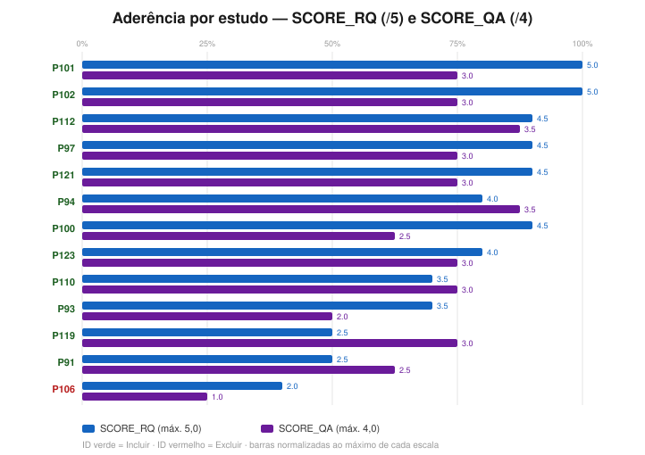
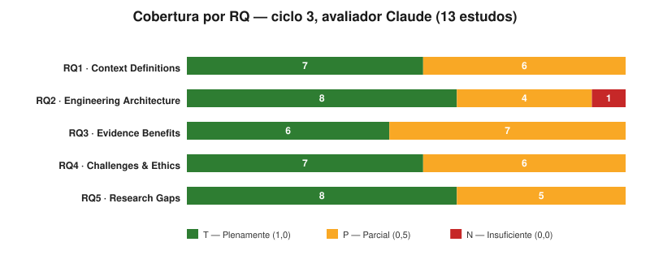
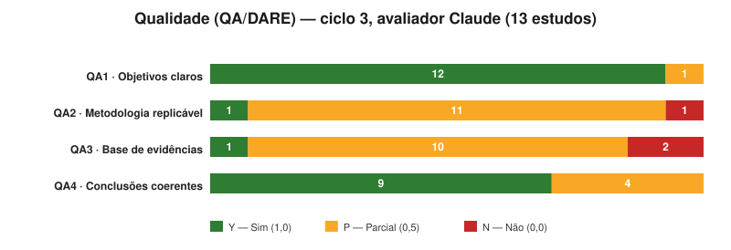
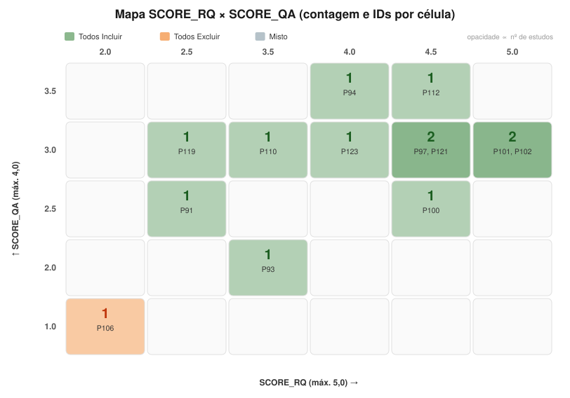
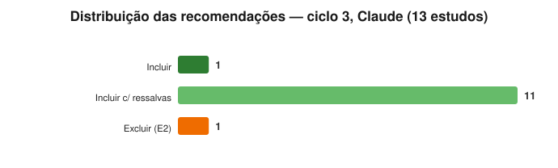

# Gráficos — Resultados do Ciclo 3 (avaliador Claude)

> 🧭 [📊 Dashboard](DASHBOARD.md) · [📈 Gráficos do ciclo 2](graficos-ciclo2.md) · [🛠️ Como criar os gráficos](COMO-CRIAR-GRAFICOS.md) · [🏠 README raiz](../README.md)

Visualizações geradas a partir de [`resultados-consolidados-ciclo3.csv`](resultados-consolidados-ciclo3.csv) — os **13 estudos avaliados na íntegra no ciclo 3 pelo avaliador Claude** (consolidação **parcial**: as avaliações ChatGPT e Gemini estão pendentes; os gráficos serão complementados quando os três conjuntos existirem). Os 18 inelegíveis da Etapa 1, o excluído na triagem (P108) e os 5 adiados por falta de texto integral não entram — ver [`triagem-ciclo3.md`](triagem-ciclo3.md). Gerados com o `scripts/gen_charts.py` apontado para o CSV do ciclo 3 (saída em `charts-ciclo3/`).

> Verde = Plenamente/Sim (T/Y) · Âmbar = Parcial (P) · Vermelho = Insuficiente/Não (N/N).

---

## 1. Aderência por estudo (SCORE_RQ e SCORE_QA)

Topo da fila: **P102** e **P101** (RQ 5,0 — cobertura plena das cinco RQs) e **P100/P97/P112/P121** (RQ 4,5). Na cauda, **P106** (RQ 2,0 · QA 1,0), único Excluir do ciclo.

## 2. Cobertura por RQ

Diferença notável para os ciclos 1–2: **RQ3 (Evidência/Benefícios) deixou de ser o ponto fraco** — o ciclo 3 traz primários com MTTD/MTTR nominal contra baseline executado (P100, P101, P102, P123).

## 3. Qualidade (QA/DARE)

## 4. Mapa SCORE_RQ × SCORE_QA

## 5. Distribuição das recomendações

**1 Incluir** (P94) · **11 Incluir c/ ressalvas** · **1 Excluir** (P106, E2).

---

## Estatísticas do ciclo (avaliador Claude, n = 13)

| Estatística | SCORE_RQ (máx. 5,0) | SCORE_QA (máx. 4,0) |
| ----------- | ------------------- | ------------------- |
| **Média**   | 3,85                | 2,77                |
| **Mediana** | 4,0                 | 3,0                 |
| Faixa       | 2,0–5,0             | 1,0–3,5             |

Bandas de QA: **9 Alta · 3 Média · 1 Baixa**. (Média ≠ mediana — rotuladas
separadamente, cf. convenção pós-errata de 2026-10-27.)

---

_Gerado em 2026-10-28 na consolidação parcial do ciclo 3. Fonte de verdade: [`resultados-consolidados-ciclo3.csv`](resultados-consolidados-ciclo3.csv) (Art. VII)._
