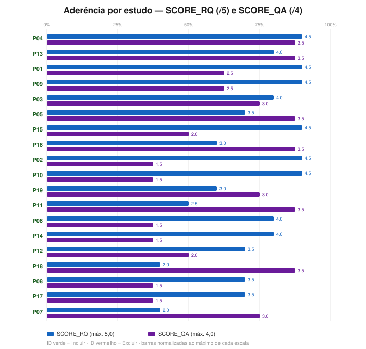
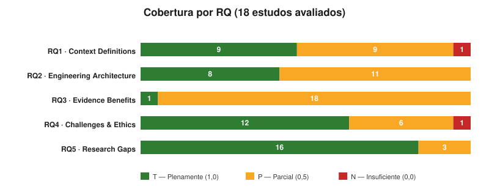
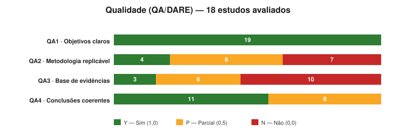
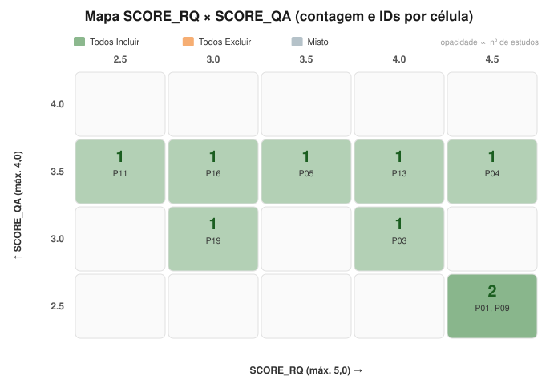
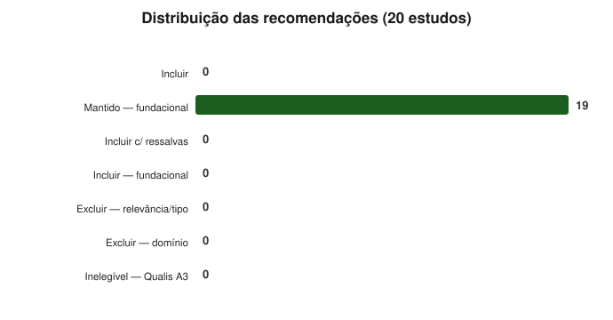

# Gráficos — Avaliação Retroativa do Corpus Fundacional (P01–P19)

> 🧭 [📊 Dashboard](DASHBOARD.md) · [📈 Gráficos do ciclo 1](graficos.md) · [📈 Gráficos do ciclo 2](graficos-ciclo2.md) · [🛠️ Como criar os gráficos](COMO-CRIAR-GRAFICOS.md) · [🏠 README raiz](../README.md)

Visualizações geradas a partir de [`resultados-consolidados-fundacionais.csv`](resultados-consolidados-fundacionais.csv) (19 estudos fundacionais do Trabalho I, avaliação retroativa de 2026-10-26 — inclusão herdada, não rediscutida). Geradas com o mesmo `scripts/gen_charts.py`, parametrizado para este CSV (saída em `charts-fundacionais/`; categoria "Mantido — fundacional" adicionada).

> Verde = Plenamente/Sim (T/Y) · Âmbar = Parcial (P) · Vermelho = Insuficiente/Não (N/N).

---

## 1. Aderência por estudo (SCORE_RQ e SCORE_QA)

Destaques: **P04** (RQ 4,5 / QA 3,5) e **P13** (4,0/3,5). O padrão dominante é **RQ alto com QA baixo** — surveys que respondem bem às questões conceituais sem validação empírica própria (P02, P10 e P15 com RQ 4,5 e QA ≤ 2,0).

---

## 2. Cobertura por questão de pesquisa (RQ)

Os fundacionais são fortes em **RQ1 (definições/autonomia)** e **RQ5 (lacunas)** — seu papel na RSL — e fracos em **RQ3 (Evidence Benefits)**, como nos ciclos 1 e 2: a escassez de evidência empírica de benefício é transversal aos três conjuntos.

---

## 3. Avaliação de qualidade (QA/DARE)

QA3 (Base de Evidências) concentra os N — 12 dos 19 são estudos secundários sem experimento próprio. Exceções empíricas: P11 (MARL), P18 (DevOps) e P13 (estudo de caso).

---

## 4. Grade RQ × QA por estudo

---

## 5. Status

**19 Mantidos (fundacionais)** — a avaliação retroativa não rediscute a inclusão (herdada do Trabalho I); o gráfico registra a categoria única do conjunto.

