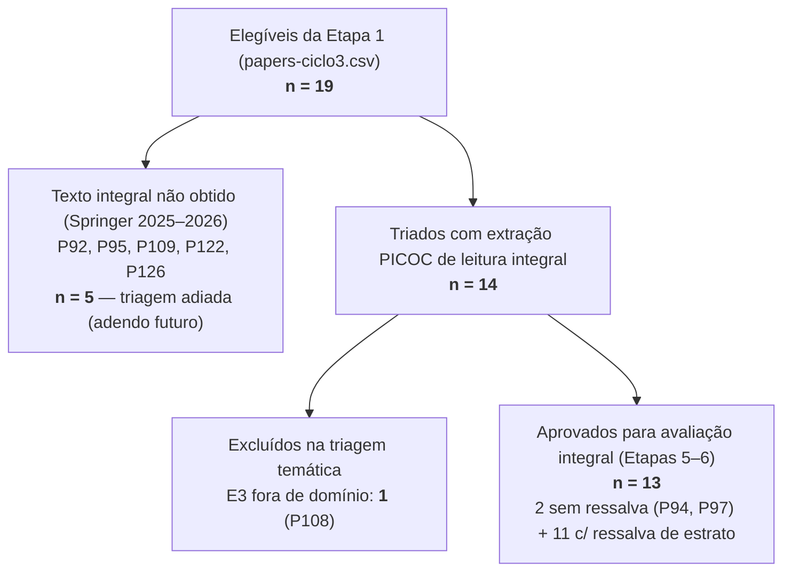

# Triagem PRISMA — Ciclo 3 (2026-10-28)

> 🧭 **Navegação:** [🏠 README raiz](../README.md) · [🧾 PRISMA](PRISMA.md) · [🧮 Elegibilidade](../papers-ciclo3.csv) · [🧩 PICOC ciclo 3](../picoc/picoc-results-ciclo3.md) · [📚 Triagem ciclo 2](triagem-ciclo2.md)

Triagem (Etapa 4 do [`WORKFLOW.md`](../WORKFLOW.md)) dos **19 candidatos do
ciclo 3 aprovados na elegibilidade bibliométrica** (Etapa 2,
[`papers-ciclo3.csv`](../papers-ciclo3.csv)) pelos critérios **I6 / E2–E5** de
[`protocolo/criterios.md`](../protocolo/criterios.md). Base de evidência: a
**extração PICOC de leitura integral**
([`picoc/picoc-results-ciclo3.md`](../picoc/picoc-results-ciclo3.md)) — toda
exclusão cita o critério, a evidência lida e o precedente de ciclo anterior.
Ressalvas de estrato conforme
[PDR-0006](../protocolo/pdr/PDR-0006-estrato-de-conference-papers-pelo-percentil-da-serie.md)
e [PDR-0007](../protocolo/pdr/PDR-0007-renovacao-da-emenda-de-estratos-para-o-ciclo-3.md).

## Resumo

| Estágio                                             | n                                         |
| --------------------------------------------------- | ----------------------------------------- |
| Candidatos identificados (descoberta)               | 37                                        |
| Elegíveis na Etapa 1 (bibliométrica)                | 19 (4 plenos + 15 c/ ressalva)            |
| Texto integral não obtido (triagem adiada)          | 5 (capítulos Springer)                    |
| Triados com evidência PICOC                         | 14                                        |
| Excluídos na triagem (por critério)                 | E1: 0 · E2: 0 · E3: **1** · E4: 0 · E5: 0 |
| **Aprovados para avaliação integral**               | **13**                                    |
| — dos quais com ressalva de estrato (PDR-0006/0007) | 11                                        |

## Fluxo da triagem

## ✅ Aprovados para avaliação integral — n = 13

| ID   | Estudo (resumo)                                          | Estrato aferido | Eixo de aderência                           | Flags para o parecer                                                                                                                          |
| ---- | -------------------------------------------------------- | --------------- | ------------------------------------------- | --------------------------------------------------------------------------------------------------------------------------------------------- |
| P91  | Arquitetura Agentic AI multiagente p/ KPIs de SOC        | ⚠️ NÃO INDEXADO | Multiagente × SOC (KPIs, MTTR/TTR)          | Agêntico não-LLM (regras+ML; análogo a P88); Comparison N/A (sem baseline)                                                                    |
| P93  | From Manual to Agentic Security Operations               | ⚠️ A3           | Agentic SOC × MTTD/MTTR (núcleo)            | Simulação (telemetria sintética); inconsistência de escala Tabelas 3 vs. 9                                                                    |
| P94  | Security framework p/ MAS baseado em MCP                 | A2 (85%)        | Segurança de agentes LLM × pipeline SOC     | Outcome = eficácia de guardrails, sem MTTD/MTTR; forte em RQ2/RQ4                                                                             |
| P97  | Agentic AI-Driven SOC-as-a-Service                       | A2 (79%)        | Agentic SOCaaS × IR cloud (núcleo)          | Tipo misto (SLR + 4 experimentos); simulação sintética ("internal feasibility")                                                               |
| P100 | AIDR-Cloud: IR agêntico p/ falhas cloud                  | ⚠️ B2 (série)   | Multiagente LLM × IR/SRE (núcleo)           | Comparison forte (baseline SREs humanos; MTTR −63%, MTTD p90 −83%)                                                                            |
| P101 | ED-ASOC: SOC agêntico event-driven                       | ⚠️ B4 (série)   | Supervisor LLM × SOC/SOAR (núcleo)          | Comparison executado (MTTR −72,3% vs. polling); testbed enterprise simulado                                                                   |
| P102 | Intelligent SRE: multiagente LLM p/ RCA                  | ⚠️ NÃO INDEXADO | Multiagente LLM × SRE/RCA (núcleo)          | Comparison executado (MTTD −82% vs. 3 SREs sêniores); dual testbed                                                                            |
| P106 | Threat hunting autônomo c/ ML+DRL                        | ⚠️ B1 (série)   | Resposta autônoma × SOC                     | **Agência nominal**: ML/DRL sem LLM/arquitetura de agentes (análogo a P73) — decidir E2 na avaliação; baseline rule-based pouco caracterizado |
| P110 | DevAIOps: SLR de agentes XAI em DevOps                   | ⚠️ A4 (série)   | Agentes × AIOps (secundário)                | Candidato a fundacional-condicional (R1, análogo a P52/P79); MTTD/MTTR de 2ª mão                                                              |
| P112 | LLMs p/ agentic NetOps/AIOps (survey)                    | A1 (98%)        | Agentic × AIOps/NetOps (secundário, núcleo) | Candidato a fundacional-condicional (R1, análogo a P24/P33); ladder of autonomy                                                               |
| P119 | RAG + CTI p/ planos de IR                                | ⚠️ A4 (série)   | LLM/RAG × IR/SOC (núcleo)                   | Agência limitada: pipeline RAG single-agent (análogo a P83); sem MTTD/MTTR numérico                                                           |
| P121 | LLMs para SOCs (survey, 216 estudos)                     | ⚠️ A3           | LLM × SOC (secundário)                      | Candidato a fundacional-condicional (R1, análogo a P52/P79)                                                                                   |
| P123 | CIPHER-A: agentic closed-loop c/ validação contrafactual | ⚠️ A3           | Agentic closed-loop × IR (núcleo)           | Comparison executado (MTTC −37,8%; DARPA OPTC), mas baselines externos indicativos (§5.4)                                                     |

⚠️ = **ressalva de estrato obrigatória** (PDR-0006/PDR-0007) em todo uso da evidência.

## ❌ Excluídos na triagem — n = 1

| ID   | Critério | Evidência PICOC (leitura integral)                                                                                                                                                                                            | Precedente                |
| ---- | -------- | ----------------------------------------------------------------------------------------------------------------------------------------------------------------------------------------------------------------------------- | ------------------------- |
| P108 | E3       | ResilioMate avalia resiliência de small language models nos seis domínios do AgentBench (OS, DB, WebShop, KG, Mind2Web, ALFWorld); o estudo não aborda incident response, MTTD/MTTR nem operações de TI — I6 falha no domínio | P38 (ciclo 1); E3 ciclo 2 |

Nota: P108 é o único candidato A1 (IEEE Access, 91%) excluído — a exclusão é
**temática** (E3), não de estrato; o framework multiagente é agêntico, mas o
domínio é benchmark genérico de agentes, fora de IR/AIOps/SOC.

## ⏳ Triagem adiada — texto integral não obtido — n = 5

Capítulos Springer 2025–2026 não licenciados via CAPES (PRISMA 2020: _reports
not retrieved_). A triagem destes candidatos será acrescentada como **adendo
datado** quando os PDFs forem obtidos (biblioteca/COMUT):

| ID   | Estudo                                                  | Estrato aferido |
| ---- | ------------------------------------------------------- | --------------- |
| P92  | AIRIN: multiagente LLM p/ IR human-led                  | ⚠️ B2 (CCIS)    |
| P95  | AIOps for Reliability: LLMs p/ RCA automatizada         | ⚠️ B1 (LNCS)    |
| P109 | LLMs no apoio à decisão humana em IR de cibersegurança  | ⚠️ B1 (LNCS)    |
| P122 | Agentic AI + NIST: detecção e resposta orientadas a KPI | ⚠️ B3 (LNNS)    |
| P126 | Multiagent incident response planning com code models   | ⚠️ B1 (LNCS)    |

## Notas metodológicas

- **Base de evidência:** cada decisão cita a extração PICOC de leitura
  integral ([`picoc-results-ciclo3.md`](../picoc/picoc-results-ciclo3.md)),
  nunca título/abstract — mesmo método do ciclo 2.
- **P106 (caso-limite documentado):** o rótulo "Agentic AI" é nominal — a
  intervenção é ML (CNN/RNN) + Deep Reinforcement Learning sem LLM nem
  arquitetura multiagente. Não há lacuna de protocolo: os precedentes P73
  (agência limitada, aprovado c/ flag) e P88 (agêntico não-LLM, aprovado)
  cobrem o caso — aprovado com flag explícita para a avaliação integral
  decidir E2 com o parecer completo, como no ciclo 1 (P26/P29/P30 foram
  excluídos **após** avaliação).
- **Secundários (P110, P112, P121):** centrados em agentes/LLM — aprovados
  como candidatos a fundacionais-condicionais pela regra R1
  ([PDR-0003](../protocolo/pdr/PDR-0003-r1-secundarios-nao-agenticos.md));
  migram para a fundamentação se o corpus se restringir a primários.
- **Cluster MTTD/MTTR com Comparison empírico (P100, P101, P102, P123):**
  primeira leva da revisão em que múltiplos primários reportam MTTD/MTTR
  nominal contra baseline executado (lacuna apontada nos ciclos 1–2) — todos,
  porém, sob ressalva de estrato.
- **Sequência:** os 13 aprovados seguem para as **Etapas 5–6**
  (`/rsl-avaliacao`: render dos prompts de avaliação + pareceres dos três
  avaliadores), com as flags desta tabela transcritas nos INSUMOS.

---

_Triagem do ciclo 3 executada em 2026-10-28 sobre papers-ciclo3.csv + PICOC
ciclo 3. Contagens: 19 elegíveis → 5 sem texto integral (adiados) → 14
triados → 1 excluído (E3) → **13 aprovados para avaliação integral** (2
plenos + 11 com ressalva de estrato)._
